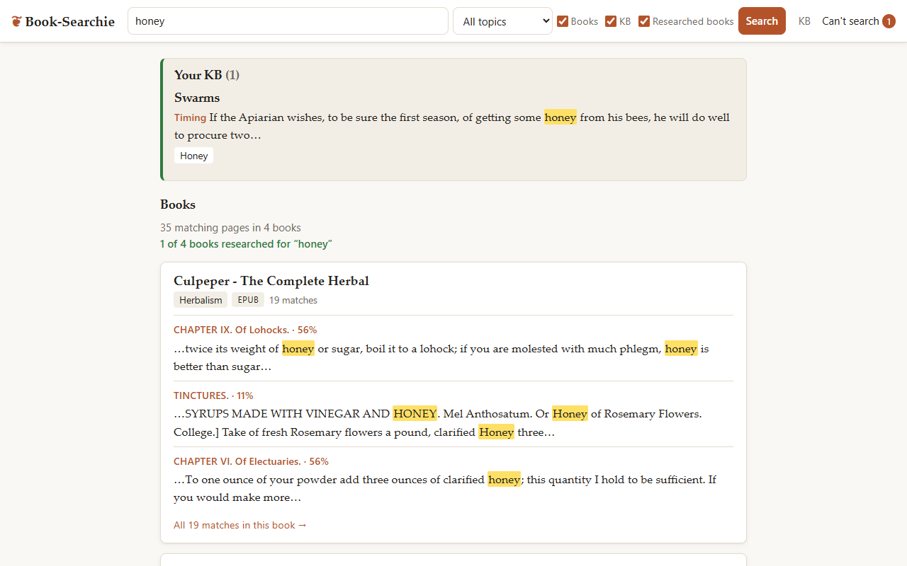
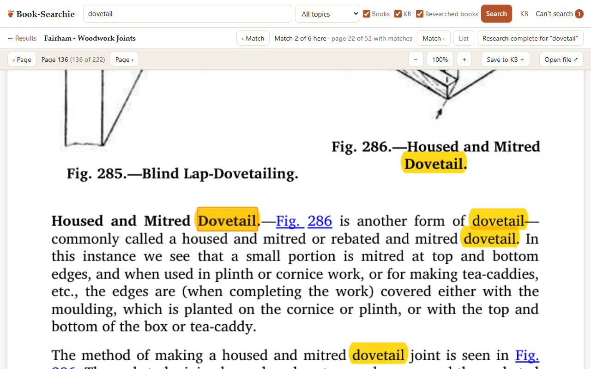
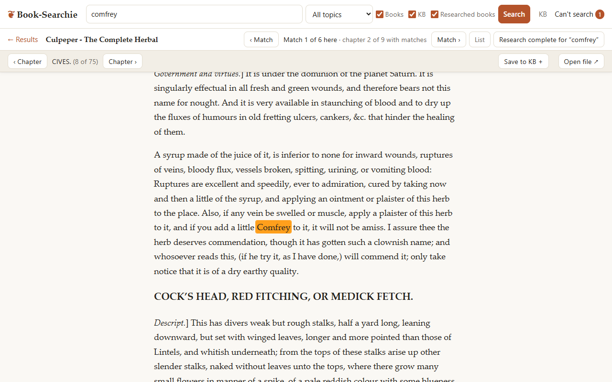
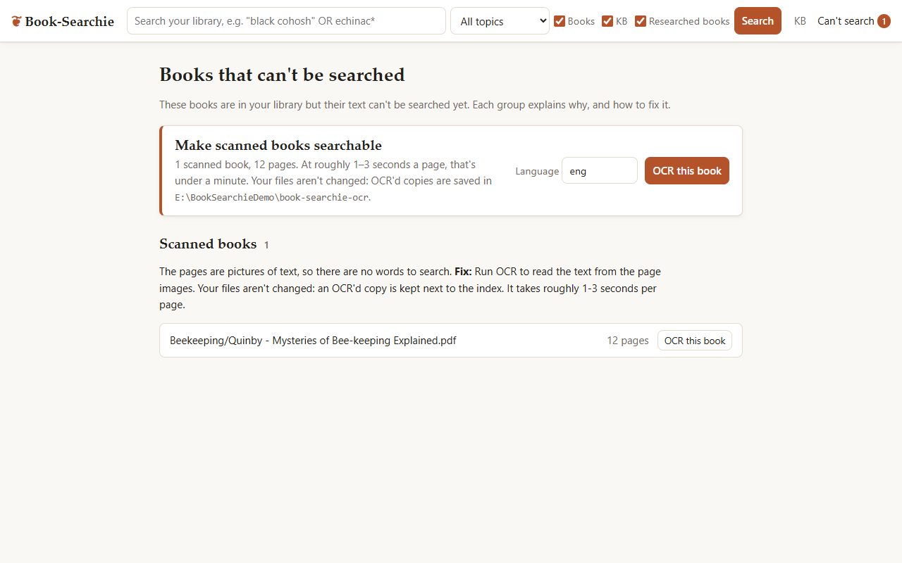
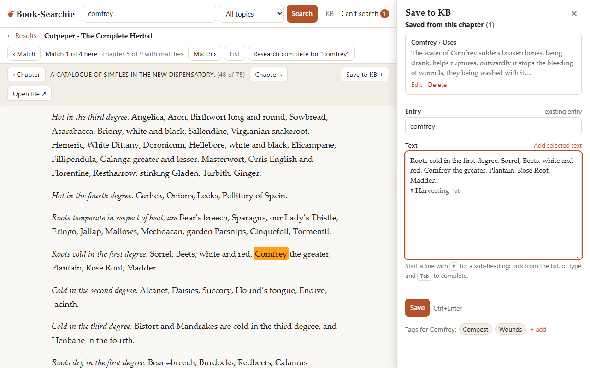
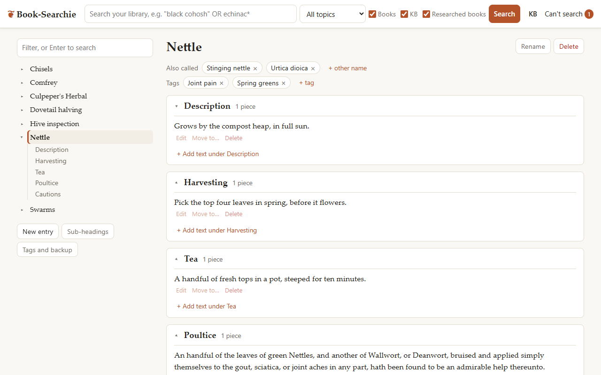

# Book-Searchie

**Turn a folder of PDFs and EPUBs into a searchable knowledge base, then open each result at the page where it was found.**

> **Status: early development.** Phases 1 and 2 work: indexing, OCR, command-line search and the web interface on your own computer, plus the KB for what you learn. Network access for other devices is a possible future enhancement, built if there's a need for it (see [Roadmap](#roadmap)). This README also serves as the development plan; sections marked *(planned)* or *(on request)* do not exist yet.

---

## What it does

- **Search your whole library instantly.** Book-Searchie reads your books once and builds a full-text index. Searches then take milliseconds, not minutes.
- **Organise by topic.** Each top-level folder in your library becomes a topic you can pick from a dropdown, plus an *All topics* option.
- **See the source.** Click a result to open the actual page:
  - **PDF:** the page is shown as an image with your search terms highlighted.
  - **EPUB:** the chapter is shown, scrolled to the match, with the terms highlighted.
- **Build a KB as you read.** Save text from the page you're reading into an entry (*Nettle*, say) under a sub-heading (*Harvesting*, *Tea*...), along with your own words and things you learned elsewhere. Search it along with your books, or on its own, and mark books as researched for a search so you know where you've been.
- **Use proper search syntax.** It supports phrases (`"black cohosh"`), `AND` / `OR` / `NOT`, prefix matching (`echinac*`), and results ranked by relevance.
- **Private by design.** It runs on your own computer and only answers requests from it. *(Hosting it on a home server for every device in the house may come later, on request.)*
- **Cross-platform.** It runs natively on Windows, macOS and Linux. No WSL needed.

## Screenshots

*These use a small demo library of public-domain books from [Project Gutenberg](https://www.gutenberg.org/).*

**Search results**, grouped by book, with the best matches first and your terms highlighted. Each result opens the page it came from.



**PDF pages** are shown as they're printed, with every match highlighted. The current match is outlined, and *Match ›* steps through each one, then on to the next page with a match.



**EPUB chapters** are shown as text, scrolled to the match.



**Books that can't be searched** are listed with the reason and a fix. Scanned books can be made searchable with OCR, without changing your files.



**Save to KB** from any page or chapter: pick the entry, and start a line with `#` for a sub-heading. Text already saved from that chapter is listed at the top.



**The KB** lists your entries on the left; each entry shows its text under its sub-headings. Search results show matching entries above the books.



## How your library is organised

Point Book-Searchie at one or more library folders. Each top-level subfolder becomes a topic:

```
D:\Books\                  <- library root (set in config)
├── Herbalism\             <- topic: "Herbalism"
│   ├── Culpeper - Complete Herbal.pdf
│   └── Modern Herbal Medicine.epub
├── Woodwork\              <- topic: "Woodwork"
│   ├── ...
│   └── _unsorted\         <- skipped (starts with "_")
├── Gardening\             <- topic: "Gardening"
│   └── Seasonal\          <- subfolders are included in their parent topic
│       └── ...
└── _inbox\                <- skipped (starts with "_")
```

To add a topic, create a folder and re-index. No code changes are needed. Books placed directly in a library root, outside any topic folder, go in a topic called *General*.

To leave a folder out, either start its name with an underscore (`_inbox`, `_to-sort`) or add it to `exclude` in the config. Underscore folders are skipped at any depth, along with everything inside them.

If a folder has the same book in more than one format, such as `Raising Goats.pdf` and `Raising Goats.epub`, only one copy is searched so results aren't doubled up. By default it's the EPUB, which has the publisher's own text and highlights exactly. If the preferred copy can't be searched (DRM, damaged, no text), the other copy is used instead. Change the preference with `prefer` in the config. `book-searchie report` lists the copies that are skipped. Only files with exactly the same name in the same folder count as the same book (capital letters don't matter).

---

## Quick start

Book-Searchie isn't on PyPI yet, so install it from a copy of this repo (see [Development](#development)). Then:

```bash
book-searchie init            # creates book-searchie.toml and asks where your library is
book-searchie index           # builds the search index (first run can take a while)
book-searchie search '"black cohosh" AND root*'
book-searchie serve           # opens http://localhost:8004 in your browser
```

**On Windows, start it with a double-click:** make a desktop shortcut to `tools\start-book-searchie.cmd` in your copy of the repo (right-click it, *Send to › Desktop (create shortcut)*), and pick `tools\book-searchie.ico` as its icon (*Properties › Change Icon*). It picks up new, changed and deleted books, then opens Book-Searchie in your browser. Close its window to stop Book-Searchie. Clicking it while Book-Searchie is already running just opens it again.

### Commands

| Command | What it does |
|---|---|
| `init [--root FOLDER]... [--force]` | Create `book-searchie.toml` in the current folder |
| `serve [-p PORT] [--no-browser]` | Start the web interface (default port 8004) |
| `index [--full] [-q]` | Add new and changed books, and drop deleted ones. `--full` re-reads everything |
| `search QUERY [-t TOPIC] [-n LIMIT]` | Search from the terminal |
| `topics` | List topics and how many books each has |
| `report` | List books that can't be searched (scanned, password-protected, DRM, damaged), and how to fix each |
| `ocr [BOOK]... [-l LANG]` | Make scanned books searchable with OCR (see [Books that can't be searched](#books-that-cant-be-searched)) |
| `notes export DEST [--format json\|md] [--book-text mark\|omit]` | Save your KB. JSON is a complete backup (`-` writes it to the screen). Markdown writes one file per entry into the folder `DEST`, with text from books marked, or left out with `--book-text omit` |
| `notes import FILE [--replace]` | Restore a JSON backup. Only into an empty KB, unless `--replace` is given; then a copy of the current KB is saved first. Backups from before entries are converted |

> **Windows PowerShell 5.1 tip:** it strips double quotes from arguments, so `'"black cohosh"'` arrives as two separate words. Escape them: `book-searchie search '\"black cohosh\"'`. Command Prompt and PowerShell 7+ don't have this problem.

Every command accepts `--config FILE` to use a config file other than `./book-searchie.toml`. You can also set `BOOK_SEARCHIE_CONFIG`.

Indexing can be interrupted with Ctrl+C at any time. Books finished so far are kept, and the next run carries on.

### The web interface

`book-searchie serve` opens the search page in your browser.

- **Recent searches** are listed on the home page, newest first, with how many pages each found. Click one to run it again, remove one with its ×, or *Clear history* to remove them all. The latest 200 are kept, in the index file, and only on your computer.
- **Results are grouped by book**, best matches first, with up to three highlighted snippets each and a link to all of a book's matches.
- **Click a result** to open the page, scrolled to the first match. PDF pages appear as images with your terms highlighted; EPUB chapters appear as text.
- **Step through matches** with the Match buttons. They go through each match on the page, then on to the next page with one, and wrap round from the last match in the book to the first. The navigation bars stay at the top of the screen as you scroll.
- **Open the book in your usual app** (Adobe Reader, Calibre and so on) with *Open file*. This always opens your original file, not the OCR copy, and is only available in local mode.
- **Keyboard:** `←` / `→` previous or next page or chapter, `n` / `p` next or previous match, `o` open file, `+` / `-` / `0` zoom PDF pages.
- **The "Can't search" page** lists books that can't be searched and why. For scanned books there's an OCR button for each book and one for all of them, with live page-by-page progress. You can leave the page while OCR runs; it carries on in the background, and the books become searchable as each one finishes.

### The KB

The KB (knowledge base) is where you gather what you learn, one **entry** per subject: a plant, a job, a tool. An
entry's text is grouped under **sub-headings** such as *Description*, *Harvesting* or *Cautions*, and can come from
three places:

- **Books:** in the viewer, press *Save to KB* (or `s`), and *Add selected text* to bring in the words you've
  selected. Text saved from a book remembers its page or chapter, so you can go back to it, and follows the book if
  you move or rename it.
- **Your own words**, typed in the same panel or added on the entry's page.
- **Other sources**, such as a course, a website or a conversation, with the source and an optional link.

**Sub-headings:** start a line with `#` and pick a sub-heading from the list, or type the start of one and press
`Tab` to complete it. Text before the first `#` goes under the first sub-heading on the list (*Description* to
start with). New sub-headings are added to the list, and *Sub-headings* on the KB page puts them in order (every
entry shows them in that order), renames or merges them.

**The KB page** lists your entries on the left; type to filter them. Each entry shows its text under its
sub-headings, where each piece can be edited, moved to another sub-heading or entry, or deleted.

**Tags and other names:** give an entry tags (*Joint pain*, *Spring greens*) and other names (*Urtica dioica*).
Searching for another name finds the entry. On *Tags and backup* you can rename or merge tags, give a tag other
names, and see every entry and the books you've marked as researched.

**Research complete:** when you've finished with a book for a search, press *Research complete* in the viewer.
That book is then listed separately in that search's results, under *Researched*, so the books you haven't read yet
come first.

**Searching:** the *Books*, *KB* and *Researched books* checkboxes beside the search box choose what to search. With
the KB ticked, matching entries are shown above the book results. Your choice is remembered.

**Tag suggestions (optional):** if you run a local AI model with [Ollama](https://ollama.com/), a *Suggest tags*
button on an entry suggests tags for it, preferring tags you already use. See
[AI tag suggestions](#ai-tag-suggestions-optional).

In local mode the server only answers requests from this computer. It also refuses requests whose address isn't `localhost`, which stops other websites from reaching it through your browser.

## Configuration

The config file is `book-searchie.toml` (`book-searchie init` creates it). Relative paths in it are relative to the config file:

```toml
[library]
roots = ["D:/Books"]              # one or more library folders
extensions = ["pdf", "epub"]
exclude = []                      # extra folders or glob patterns to skip, e.g. ["Archive", "**/drafts"]
                                  # (folders starting with "_" are always skipped)
prefer = "epub"                   # same book as PDF and EPUB in one folder: search only this one

[index]
path = "book-searchie.db"         # SQLite index file

[notes]
path = "book-searchie-notes.db"   # your KB: your own work, so back this file up
# Sub-headings for KB entries, in the order they're shown. The first is used when you don't
# pick one, and you can always type a new one.
headings = ["Description", "Identification", "Harvesting", "Tea", "Tincture", "Poultice", "Infused oil", "Cautions"]

[ai]                              # optional tag suggestions from a local AI model
enabled = false
endpoint = "http://localhost:11434"   # Ollama
model = "llama3.2"

[server]
mode = "local"                    # only "local" for now (network mode may come later, on request)
host = "127.0.0.1"
port = 8004
```

Environment variables override the config file, which is handy for scripts and services:

| Variable | Setting |
|---|---|
| `BOOK_SEARCHIE_ROOTS` | `library.roots`, separated like `PATH` (`;` on Windows, `:` elsewhere) |
| `BOOK_SEARCHIE_EXTENSIONS` | `library.extensions`, comma-separated |
| `BOOK_SEARCHIE_EXCLUDE` | `library.exclude`, comma-separated |
| `BOOK_SEARCHIE_PREFER` | `library.prefer` (`epub` or `pdf`) |
| `BOOK_SEARCHIE_INDEX` | `index.path` |
| `BOOK_SEARCHIE_NOTES` | `notes.path` |
| `BOOK_SEARCHIE_MODE`, `_HOST`, `_PORT` | `server.mode`, `server.host`, `server.port` |

If `BOOK_SEARCHIE_ROOTS` is set, no config file is needed at all.

### Backing up your KB

The search index can always be rebuilt from your books, but your KB is your own work and can't be. It's kept in its
own file, `book-searchie-notes.db` by default, which you should include in your backups. You can also download a
backup from the KB's *Tags and backup* page, or run `book-searchie notes export backup.json`; restore it with
`book-searchie notes import backup.json`. When an update to Book-Searchie changes how the KB is stored, a copy of
the file is saved first, next to it (e.g. `book-searchie-notes.db.v4.bak`).

Markdown exports (`--format md`, or a zip from *Tags and backup*) write one file per entry, with its sub-headings
as headings, for reading in other apps such as Obsidian. Text saved from a book is marked as such, so you can tell
it from your own words; or leave it out (`--book-text omit`) for a copy you could publish. Markdown can't be
imported back: keep a JSON backup too.

### AI tag suggestions (optional)

Book-Searchie can ask an AI model running on your own computer to suggest tags for a KB entry. It's off unless you turn
it on, and everything else works without it.

1. Install [Ollama](https://ollama.com/) and download a model: `ollama pull llama3.2`. Small models are fine for
   this; larger ones suggest better tags but are slower.
2. Turn it on in the config and restart Book-Searchie:

   ```toml
   [ai]
   enabled = true
   model = "llama3.2"
   ```

A *Suggest tags* button then appears beside an entry's tags. Suggestions are shown as chips; click one to add it.
Nothing is added unless you click. Tags you already use are suggested first, so your tags don't fill up with near
duplicates. The first suggestion after starting can take a while, as the model loads.

**Privacy:** only the entry's text and the names of your tags are sent, and only to the endpoint in the
config. That has to be on this computer: Book-Searchie won't start with an endpoint elsewhere unless you add
`allow_remote = true` to `[ai]`.

---

## Deployment modes

### 1. Local (default)

Book-Searchie listens only on `127.0.0.1`, so only your own computer can reach it. No login is required. This is the safe default.

```bash
book-searchie serve
```

### 2. Home server / network *(on request)*

> **Not being built for now.** This is a design sketch for a possible future enhancement. It will be built if there's a need for it, so if you'd use it, add a 👍 or a comment to [issue #1](https://github.com/bugbountymillionaire/book-searchie/issues/1) saying how you'd run it (always-on PC, NAS, Docker…).

Run Book-Searchie on a home server, NAS or always-on PC, and use it from phones, tablets and laptops on your network.

```bash
book-searchie serve --mode network        # listens on 0.0.0.0:8004
```

In network mode:

- **Login is required.** Book-Searchie refuses to start in network mode until at least one user exists:
  ```bash
  book-searchie user add alice
  book-searchie user add bob --admin
  ```
  Passwords are stored hashed, never in plain text.
- **Users have two roles:** *readers* can search and view; *admins* can also trigger re-indexing and manage users from the web UI.
- **Topics can be restricted per user** *(optional)*, for example to keep a private topic hidden from other household members.
- **The library is read-only.** Book-Searchie never modifies, moves or deletes your books.
- **It works on phones.** The interface is responsive, and the page viewer supports pinch-zoom.

#### Docker *(on request)*

This is the easiest option for a NAS or home server:

```yaml
# docker-compose.yml
services:
  book-searchie:
    image: ghcr.io/bugbountymillionaire/book-searchie:latest
    ports:
      - "8004:8004"
    volumes:
      - /path/to/your/library:/library:ro    # mounted read-only
      - ./data:/data                          # index + config + users
    environment:
      BOOK_SEARCHIE_MODE: network
    restart: unless-stopped
```

#### HTTPS and access from outside your home

Book-Searchie serves plain HTTP. On a home network that is usually fine. **Don't expose it directly to the internet.** For remote access, use one of these:

- a VPN into your home network (WireGuard, Tailscale, etc.), **recommended**, or
- a reverse proxy with HTTPS (Caddy, Nginx, Traefik) in front of Book-Searchie.

Example configs for both would be included in `docs/`.

---

## Architecture

```
┌──────────────┐     ┌───────────────────┐     ┌──────────────────┐
│ Library      │────>│ Indexer           │────>│ SQLite FTS5      │
│ PDFs / EPUBs │     │ PyMuPDF / zipfile │     │ 1 row per PDF    │
└──────────────┘     └───────────────────┘     │ page or EPUB     │
                                               │ chapter          │
                                               └────────┬─────────┘
                                                        │
┌──────────────┐     ┌───────────────────┐              │
│ Browser      │<───>│ Web server        │<─────────────┘
│ (this        │     │ FastAPI           │
│  computer)   │     │ search · render   │
└──────────────┘     └───────────────────┘
```

| Component | Choice | Why |
|---|---|---|
| Language | Python 3.11+ | Cross-platform, easy to install |
| Index | SQLite FTS5 (included in Python's standard builds) | No separate database server; fast; ranks results |
| PDF text and rendering | PyMuPDF | Finds the exact position of each match; renders pages with highlights; has Windows/macOS/Linux wheels |
| EPUB | `zipfile` + HTML parsing | EPUBs are zip files of HTML chapters |
| Web | FastAPI + server-rendered HTML | Small and simple; no frontend build step |

### Indexing

- **One-time and incremental:** each file's size and modified time are recorded, so re-indexing only processes new or changed files, and removes entries for deleted ones.
- **Moves and renames are recognised:** a file that turns up elsewhere in the library with the same size, modified time and type is treated as the same book. Its topic and title are updated without reading it again, and links to its pages keep working. If that can't tell two identical files apart, they're simply read again.
- **Text normalisation:** ligatures (`fi` becomes `fi`), odd whitespace and hyphenated line breaks are cleaned up so searches match.
- **Problem books are reported, not skipped silently.** See below.

### Books that can't be searched

After indexing, `book-searchie index` says how many books couldn't be read, and `book-searchie report` lists them by problem, with the fix for each:

| Problem | What it means | Fix |
|---|---|---|
| **Scanned** | The pages are pictures of text, with no text layer to search | `book-searchie ocr` (below) |
| **Password-protected** | The PDF needs a password just to open it | Remove the password once, e.g. open it and *Print to PDF*, or `qpdf --decrypt --password=PASSWORD locked.pdf unlocked.pdf`, then replace the file |
| **DRM-protected** | A shop (Adobe Digital Editions, Apple Books, Readium LCP, ...) has encrypted the book so only its own app can open it | Get a DRM-free copy. Book-Searchie doesn't remove DRM: doing so is unlawful in the UK, US and many other countries |
| **Damaged** | The file is corrupt or not really a PDF/EPUB | Re-download or replace it |

PDFs that only restrict printing or copying are indexed normally.

#### OCR for scanned books

`book-searchie ocr` uses [OCRmyPDF](https://github.com/ocrmypdf/OCRmyPDF) and Tesseract to read the text from page images. **Your files are never changed:** the OCR'd copy is saved in a cache folder next to the index (`book-searchie-ocr/`), and Book-Searchie searches and displays that copy instead. Copies are named by the original's SHA-256 fingerprint, so they survive the book being renamed or moved, and are ignored if the book itself changes.

OCR is optional and needs extra software: the OCRmyPDF package and the Tesseract OCR program. (Ghostscript isn't needed, because Book-Searchie asks for plain PDF output rather than PDF/A.)

```bash
pip install "book-searchie[ocr]"                 # or: pip install -e ".[ocr]" from a checkout
winget install UB-Mannheim.TesseractOCR          # Windows
brew install tesseract                           # macOS
sudo apt install tesseract-ocr                   # Linux (Debian/Ubuntu)
```

For languages other than English, install Tesseract's language data too (on Windows, pick the languages in the Tesseract installer).

Then:

```bash
book-searchie ocr                                    # every scanned book in the report
book-searchie ocr "Herbalism/Culpeper's Complete Herbal.pdf"
book-searchie ocr --language eng+lat "Herbalism/Old Herbal.pdf"   # Tesseract language codes
```

It takes roughly 1–3 seconds per page. Ctrl+C stops at any point: finished books are kept, and the next run carries on. Pages that already have text are left alone, so partly scanned books work too.
- **FTS5 check:** some Linux distributions build Python's SQLite without FTS5. Book-Searchie checks for it at startup and explains how to fix it if it's missing.

### Locations in results

- **PDF:** the page number, using the book's printed page labels where the PDF has them (e.g. `xii`, `147`), otherwise the physical page number.
- **EPUB:** EPUBs have no fixed pages, so a result shows the chapter title and how far through the chapter the match is (e.g. *Chapter 4: Roots · 35%*).

### Security notes

- **No path traversal:** every file path served is checked to be inside a configured library root.
- **Escaped text:** text extracted from books is HTML-escaped before display.
- **No shell commands:** Book-Searchie never runs shell commands built from user input.
- **The KB is only changed by the app itself:** requests that change it need a header that other websites can't send.
- **Safe formatting:** KB text is escaped before their formatting is applied, and links can only be `http` or `https`.
- **AI stays local:** see [AI tag suggestions](#ai-tag-suggestions-optional).

---

## Roadmap

### Phase 1: Core
- [x] Project skeleton (`pyproject.toml`, CLI entry point, config loading)
- [x] Indexer: PDF pages + EPUB chapters into SQLite FTS5
- [x] Folder exclusions (`_`-prefixed folders plus `exclude` patterns)
- [x] Incremental re-indexing
- [x] CLI search (`book-searchie search "term"`) for testing
- [x] Unsearchable files report (`book-searchie report`), with a fix for each problem
- [x] Password and DRM detection
- [x] Optional OCR for scanned PDFs (`book-searchie ocr`), without modifying the library

### Phase 2: Web UI (local mode)
- [x] Search page with topic dropdown
- [x] Results grouped by book, with highlighted snippets
- [x] PDF page viewer with highlighted matches
- [x] EPUB chapter viewer, scrolled to the match
- [x] Previous/next match navigation within a book
- [x] "Can't search" page, with OCR buttons and live progress

### KB: what you learn
- [x] KB store in its own file, upgraded safely when it changes
- [x] Entries with sub-headings, in one ordered list you can change
- [x] Save to KB from the viewer, with `#` for sub-headings
- [x] Text from books that follows its book when it's moved or renamed
- [x] KB page: entries beside their text, sub-headings, tags and other names
- [x] Research complete: researched books listed separately for a search
- [x] Search books, the KB, researched books, or any mix
- [x] Rename and merge tags and sub-headings, other names for tags
- [x] Backup and restore (JSON), one Markdown file per entry
- [x] Optional tag suggestions from a local AI model

### Phase 3: Nice to have
- [ ] Watch folders and re-index automatically (`watch = true` in `[index]`)
- [ ] Book cover thumbnails
- [ ] Search history and saved searches
- [ ] Filters by file type or book
- [ ] Windows `.exe` via PyInstaller

### Release checklist
- [x] Demo library of public-domain books from Project Gutenberg, for trying it out (`tools/demo_library.py`)
- [x] Screenshots in this README
- [ ] Tests running on Windows, macOS and Linux (GitHub Actions)
- [x] `LICENSE` file (MIT)
- [ ] Publish to PyPI

### Future enhancement, on request: network access
Not scheduled. It will be built if there's a need for it; tracked in [issue #1](https://github.com/bugbountymillionaire/book-searchie/issues/1). See [Home server / network](#2-home-server--network-on-request) for the design.
- [ ] `--mode network` with user accounts and login (session cookies, hashed passwords)
- [ ] Reader/admin roles; OCR and re-index from the web UI for admins
- [ ] Optional per-user topic restrictions
- [ ] Docker image + compose example, published to GitHub Container Registry
- [ ] Reverse proxy and VPN docs

---

## Development

Keep this repo **outside your book library**, not in a subfolder of a library root. That way the indexer won't pick up the source code, and you can't accidentally commit copyrighted books.

```bash
git clone https://github.com/bugbountymillionaire/book-searchie.git
cd book-searchie
python -m venv .venv
.venv\Scripts\activate          # Windows
# source .venv/bin/activate     # macOS / Linux
pip install -e ".[dev]"         # add ,ocr  (".[dev,ocr]") to work on OCR
pytest                          # run the tests
```

The tests generate their own small PDFs and EPUBs, so they don't need a real library.

To try Book-Searchie without your own books, or to update the screenshots above, there's a demo library of public-domain books from Project Gutenberg:

```bash
python tools/demo_library.py E:/BookSearchieDemo     # downloads 7 books (~35 MB) and indexes them
cd E:/BookSearchieDemo && book-searchie serve        # http://localhost:8005

pip install -e ".[screenshots]"                      # Playwright
python tools/screenshots.py E:/BookSearchieDemo --browser msedge   # or chrome; writes docs/screenshots/
```

Build the demo outside your user folder: the "Can't search" screenshot shows the demo's path.

The `.gitignore` should exclude `*.db`, `book-searchie.toml`, `.venv/` and any local library folders.

## License

MIT, see [LICENSE](LICENSE).

Book-Searchie uses [PyMuPDF](https://pymupdf.readthedocs.io/), which is licensed under the AGPL (or commercially by Artifex). That doesn't affect using Book-Searchie or its own MIT-licensed source, but anyone distributing it bundled with PyMuPDF (for example as an `.exe` or container image) needs to meet the AGPL's terms for that bundle.
